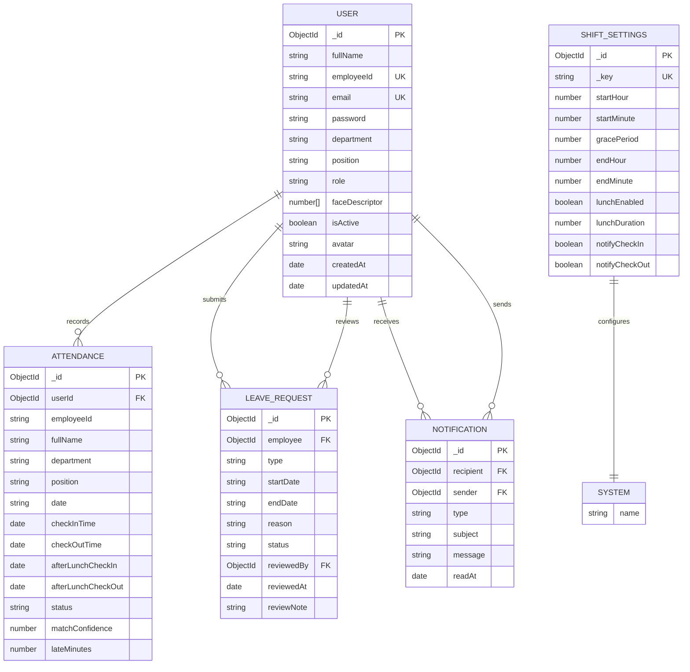

# Smart Attendance System ER Diagram

## Export Instructions

1. Open this file in VS Code or copy the Mermaid block.
2. Paste it into https://mermaid.live.
3. Select **Actions** and choose **Download PNG**, **Download SVG**, or **Download Markdown**.
